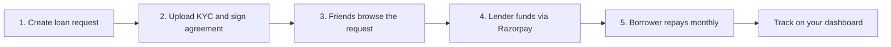

<div align="center">

# 🤝 FriendFunds

### *Lend Smart. Borrow Easy. Stay Friends.*

**A peer-to-peer lending platform that turns informal loans between friends into a clear, documented process with fixed interest and monthly installments.**

[](https://friendfunds.vercel.app)
[](#-loan-terms)
[](#️-tech-stack)
[](#)

[**🚀 Live Demo**](https://friendfunds.vercel.app) · [**✨ Features**](#-features) · [**🧭 How It Works**](#-how-it-works) · [**⚙️ Getting Started**](#️-getting-started) · [**🤝 Contributing**](#-contributing)

</div>

---

## 📌 Table of Contents

- [About the Project](#-about-the-project)
- [The Problem](#-the-problem)
- [Our Solution](#-our-solution)
- [Features](#-features)
- [How It Works](#-how-it-works)
- [Loan Terms](#-loan-terms)
- [Tech Stack](#️-tech-stack)
- [Getting Started](#️-getting-started)
- [Project Structure](#-project-structure)
- [Roadmap](#️-roadmap)
- [Contributing](#-contributing)
- [Author](#-author)

---

## 📖 About the Project

**FriendFunds** replaces the awkward "can you lend me some money?" conversation with a structured, transparent process. Borrowers post a loan request, friends fund it, and repayment follows a fixed monthly schedule so everyone knows exactly where they stand.

🔗 **Live application:** [friendfunds.vercel.app](https://friendfunds.vercel.app)

---

## ❗ The Problem

- Loans between friends are usually **informal and undocumented**, which strains relationships.
- There is **no clear repayment schedule**, so money is forgotten or delayed.
- Lenders have **no proof of identity or agreement** if something goes wrong.
- Neither side has a **simple view** of what is owed and when.

## 💡 Our Solution

FriendFunds brings structure to trust:

1. **Request** a loan with a clear purpose, amount and term.
2. **Verify** with KYC documents and a signed agreement.
3. **Fund** the request securely with Razorpay.
4. **Repay** through predictable monthly installments.

---

## ✨ Features

| | Feature | Description |
|---|---|---|
| 📝 | **Loan requests** | Borrow ₹1,000 to ₹1,00,000 over 6, 12, 18 or 24 months. |
| 📈 | **Invest and earn** | Browse requests from friends and fund them at a fixed 8% annual return. |
| 📅 | **Monthly installments** | A predictable repayment schedule with a clear monthly amount. |
| 🪪 | **KYC and agreements** | Aadhaar and signed undertaking upload before a loan goes live. |
| 💳 | **Secure payments** | Checkout through Razorpay: cards, UPI and net banking. |
| 📊 | **Personal dashboard** | Tabs for borrowed loans, lent loans, profile and uploaded documents. |
| 🔐 | **Accounts** | Register, login and password reset flows. |
| 📱 | **Responsive UI** | Works smoothly on desktop and mobile. |

---

## 🧭 How It Works



| Step | What happens |
|:---:|---|
| **1** | **Create a request** with purpose, amount and term. |
| **2** | **Verify** by uploading Aadhaar and a signed undertaking, and accept the terms. |
| **3** | **Browse** active requests under Investment Opportunities. |
| **4** | **Fund** a loan securely through Razorpay. |
| **5** | **Repay** in fixed monthly installments. |

---

## 📋 Loan Terms

| Term | Details |
|---|---|
| **Interest** | 8% per annum, fixed |
| **Repayment** | Monthly installments |
| **Late fee** | 2% on overdue amounts |
| **Prepayment** | No penalty |
| **Amount range** | ₹1,000 to ₹1,00,000 |
| **Tenure** | 6, 12, 18 or 24 months |

---

## 🛠️ Tech Stack

| Layer | Technology |
|---|---|
| **Frontend** | HTML5, CSS3, vanilla JavaScript (ES modules) |
| **Backend and Storage** | Supabase |
| **Payments** | Razorpay |
| **Icons and Fonts** | Font Awesome, Poppins |
| **Deployment** | Vercel |

---

## ⚙️ Getting Started

### Prerequisites

- [Node.js](https://nodejs.org/) (only to run a local static server)
- A Git client

### Installation

```bash
# 1. Clone the repository
git clone https://github.com/raunakdubey7891-del/friendfunds.git

# 2. Move into the project folder
cd friendfunds
```

### Run Locally

```bash
# ES modules need a server, not file://
npx serve .
```

Open the local URL shown in your terminal.

> ⚠️ Add your own Supabase and Razorpay keys in `script.js` to enable storage and payments. Never expose secret keys in client-side code.

---

## 📁 Project Structure

```
friendfunds/
├── index.html    # Markup, modals and layout
├── style.css     # Styling
└── script.js     # App logic
```

---

## 🗺️ Roadmap

- [x] Loan requests with fixed 8% interest
- [x] KYC and agreement upload
- [x] Razorpay checkout
- [x] Borrowed and lent loan dashboards
- [ ] Repayment reminders
- [ ] Notifications for lenders and borrowers
- [ ] Downloadable loan agreements
- [ ] Admin dashboard for KYC review

---

## 🤝 Contributing

Contributions, issues and feature requests are welcome!

1. Fork the project
2. Create your feature branch: `git checkout -b feature/amazing-feature`
3. Commit your changes: `git commit -m "Add amazing feature"`
4. Push to the branch: `git push origin feature/amazing-feature`
5. Open a Pull Request

---

## 👤 Author

**Raunak Dubey**
MCA, Pondicherry University

[](https://github.com/raunakdubey7891-del)

---

<div align="center">

⭐ If you like this project, please consider giving it a star! ⭐

*Made with ❤️ for friends who lend and borrow.*

</div>
